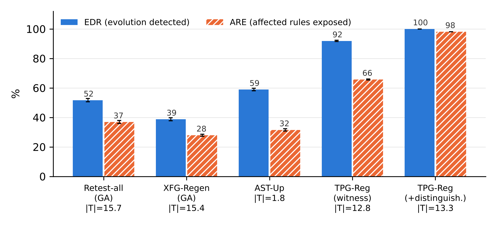

# TPG-Reg — experiment report
All numbers below are produced by the scripts in `experiments/` (see `run_all.sh`). EDR = evolution detection rate, ARE = affected-rule exposure, |T| = tests per evolution; mean over seeds 1–5 (± population SD).

## Benchmark policy sets and TPG sizes

| Set | Rules | Policies | \|D\| | \|V\| | \|E\| | precedes/overrides/refers | Evolutions | Behaviour-changing |
|---|---|---|---|---|---|---|---|---|
| HACS | 25 | 5 | 92160 | 104 | 194 | 3/4/3 | 164 | 126 |
| FMS | 30 | 3 | 172800 | 111 | 278 | 12/63/2 | 172 | 129 |
| SIS | 20 | 4 | 20480 | 83 | 160 | 12/2/1 | 126 | 108 |

## Impact analysis and edge-type ablation (363 behaviour-changing single-edit evolutions)

| Variant | BIS recall % | BIS precision % | Evolutions with missed affected rule | mean \|BIS\| | EDR % | ARE % | \|T\| | Equivalent evolutions with non-empty impact (of 99) |
|---|---|---|---|---|---|---|---|---|
| AST-Up | 35.5 | 59.7 | 188 | 1.7 | 58.9 | 31.5 | 1.8 | 83 |
| TPG-Reg | 100.0 | 27.6 | 0 | 10.1 | 91.8 | 65.8 | 12.8 | 34 |
| -precedes | 87.8 | 32.4 | 64 | 7.6 | 90.4 | 61.8 | 9.3 | 34 |
| -overrides | 63.3 | 46.3 | 145 | 3.8 | 92.1 | 58.1 | 5.4 | 34 |
| -scopes | 98.2 | 27.8 | 8 | 9.9 | 91.7 | 64.9 | 12.4 | 30 |
| -refers | 98.3 | 27.3 | 8 | 10.0 | 89.8 | 64.3 | 12.7 | 34 |

BIS recall per dataset (%):


| Set | AST-Up | TPG-Reg | -precedes | -overrides | -scopes | -refers |
|---|---|---|---|---|---|---|
| HACS | 50.4 | 100.0 | 94.0 | 79.9 | 95.7 | 95.7 |
| FMS | 24.0 | 100.0 | 92.4 | 43.4 | 99.8 | 98.7 |
| SIS | 48.4 | 100.0 | 70.0 | 95.5 | 96.9 | 100.0 |

## Regression detection on single-edit evolutions
Retest-all / XFG-Regen: path-based flow-graph suites of P1 / P2 (one request per rule path), minimised by a genetic algorithm (GA) or greedy set cover. TPG-Reg(raw): witnesses without minimisation.


| Method | HACS EDR % | HACS ARE % | HACS \|T\| | FMS EDR % | FMS ARE % | FMS \|T\| | SIS EDR % | SIS ARE % | SIS \|T\| | ALL EDR % | ALL ARE % | ALL \|T\| |
|---|---|---|---|---|---|---|---|---|---|---|---|---|
| Retest-all(GA) | 66.5±3.3 | 59.3±2.9 | 19.4 | 40.5±1.4 | 26.9±1.4 | 13.9 | 47.8±2.1 | 38.2±1.5 | 13.6 | 51.7±1.1 | 36.9±1.0 | 15.7 |
| Retest-all | 64.3±2.1 | 57.5±1.6 | 18.2 | 41.1±2.5 | 25.3±1.2 | 12.4 | 45.6±3.3 | 38.5±2.9 | 12.8 | 50.5±1.9 | 35.7±0.9 | 14.6 |
| XFG-Regen(GA) | 49.0±2.5 | 41.7±1.7 | 18.9 | 30.1±2.6 | 21.4±1.8 | 13.7 | 37.2±4.1 | 29.9±3.2 | 13.3 | 38.8±1.1 | 27.9±0.7 | 15.4 |
| XFG-Regen | 48.1±2.2 | 42.1±1.2 | 17.9 | 25.6±2.3 | 17.9±1.8 | 12.4 | 30.0±2.5 | 24.9±2.6 | 12.4 | 34.7±1.5 | 25.1±1.6 | 14.3 |
| AST-Up | 67.5±1.3 | 47.4±0.8 | 1.7 | 48.8±1.6 | 21.0±1.3 | 1.9 | 60.9±2.9 | 41.0±2.0 | 1.6 | 58.9±0.8 | 31.5±0.7 | 1.8 |
| TPG-Reg | 98.3±0.3 | 87.7±0.3 | 3.8 | 86.8±1.1 | 52.3±0.6 | 23.8 | 90.4±0.5 | 76.3±0.3 | 10.0 | 91.8±0.4 | 65.8±0.3 | 12.8 |
| TPG-Reg(raw) | 99.4±0.6 | 97.5±0.8 | 12.3 | 94.9±1.4 | 88.0±1.6 | 135.0 | 98.9±0.9 | 95.2±1.9 | 29.9 | 97.6±0.6 | 91.8±1.2 | 61.2 |
| TPG-Reg+D | 100.0±0.0 | 98.3±0.0 | 4.0 | 100.0±0.0 | 98.2±0.0 | 24.9 | 100.0±0.0 | 97.8±0.0 | 10.3 | 100.0±0.0 | 98.1±0.0 | 13.3 |

EDR (%) per edit operator (behaviour-changing evolutions in parentheses):


| Method | CAC (22) | CCF (146) | CRE (71) | PRO (1) | PTC (20) | RAI (17) | RDL (69) | RRO (6) | VDC (11) |
|---|---|---|---|---|---|---|---|---|---|
| Retest-all(GA) | 60.0 | 50.5 | 58.9 | 0.0 | 71.0 | 34.1 | 48.7 | 66.7 | 10.9 |
| Retest-all | 62.7 | 49.6 | 60.6 | 0.0 | 67.0 | 24.7 | 45.8 | 63.3 | 9.1 |
| XFG-Regen(GA) | 70.9 | 32.6 | 61.7 | 0.0 | 58.0 | 71.8 | 8.1 | 63.3 | 5.5 |
| XFG-Regen | 58.2 | 29.2 | 57.2 | 0.0 | 54.0 | 65.9 | 5.8 | 56.7 | 5.5 |
| AST-Up | 12.7 | 61.5 | 79.2 | 0.0 | 24.0 | 80.0 | 60.3 | 83.3 | 0.0 |
| TPG-Reg | 84.5 | 93.7 | 98.6 | 0.0 | 80.0 | 82.4 | 95.1 | 83.3 | 67.3 |
| TPG-Reg(raw) | 100.0 | 97.3 | 99.7 | 100.0 | 100.0 | 95.3 | 98.3 | 100.0 | 78.2 |
| TPG-Reg+D | 100.0 | 100.0 | 100.0 | 100.0 | 100.0 | 100.0 | 100.0 | 100.0 | 100.0 |



### Significance tests (paired over behaviour-changing evolutions)

| Comparison | EDR Wilcoxon p | EDR A12 | ARE Wilcoxon p | ARE A12 | McNemar b | McNemar c | McNemar p |
|---|---|---|---|---|---|---|---|
| TPG-Reg vs Retest-all | 1.16e-41 | 0.76 | 8.10e-44 | 0.74 | 153 | 5 | 4.4e-39 |
| TPG-Reg vs XFG-Regen | 2.82e-50 | 0.82 | 1.91e-51 | 0.82 | 216 | 0 | 1.9e-65 |
| TPG-Reg vs Retest-all(GA) | 1.57e-41 | 0.78 | 5.31e-42 | 0.75 | 147 | 2 | 3.1e-41 |
| TPG-Reg vs XFG-Regen(GA) | 1.86e-48 | 0.83 | 1.85e-49 | 0.82 | 199 | 5 | 2.2e-52 |
| TPG-Reg vs AST-Up | 1.16e-37 | 0.73 | 4.34e-39 | 0.70 | 120 | 1 | 9.2e-35 |
| TPG-Reg+D vs Retest-all | 5.68e-49 | 0.82 | 6.06e-53 | 0.85 | 179 | 0 | 2.6e-54 |
| TPG-Reg+D vs XFG-Regen | 1.21e-56 | 0.87 | 1.17e-59 | 0.91 | 247 | 0 | 8.8e-75 |
| TPG-Reg+D vs Retest-all(GA) | 2.85e-51 | 0.84 | 8.96e-55 | 0.87 | 176 | 0 | 2.1e-53 |
| TPG-Reg+D vs XFG-Regen(GA) | 2.17e-56 | 0.88 | 2.91e-59 | 0.91 | 225 | 0 | 3.7e-68 |
| TPG-Reg+D vs AST-Up | 5.68e-45 | 0.79 | 2.39e-49 | 0.82 | 150 | 0 | 1.4e-45 |

## Oracle correctness: path-based oracle vs. decisive witness

| Set | Rules | Path-oracle errors per suite | Error rate % | Rules with p(wrong)>0 | Mean p(wrong) % | W1 errors (5 seeds) | Never-decisive rules | W1 unsatisfiable |
|---|---|---|---|---|---|---|---|---|
| HACS | 25 | 2.0 | 8.0 | 5 | 7.0 | 0/120 | H.R13 | H.R13 |
| FMS | 30 | 5.4 | 18.0 | 19 | 23.9 | 0/145 | F.R12 | F.R12 |
| SIS | 20 | 2.8 | 14.0 | 8 | 12.6 | 0/100 | - | - |

## Change-aware (intent) oracle on two-edit commits (120 clean, 120 with an undeclared edit)

| Method | Clean: false alarm % | Clean: detect % | Dirty: flagged % | Dirty: detect % | Dirty: \|T\| |
|---|---|---|---|---|---|
| Retest-all | 0.0 | 52.2 | 50.2 | 77.3 | 14.5 |
| XFG-Regen | 0.0 | 35.3 | 35.5 | 59.7 | 14.2 |
| AST-Up | 0.0 | 59.5 | 51.8 | 80.3 | 3.2 |
| TPG-Reg | 0.0 | 93.2 | 91.3 | 99.0 | 18.5 |
| TPG-Reg+D | 0.0 | 100.0 | 97.0 | 100.0 | 19.3 |
| Exhaustive (all requests) | 0.0 | 100 | 99.2 | 100 | - |

## Scalability with the Z3 backend (synthetic policies, integer domains [0, 10^6])

| n | \|E*\| | build s | Z3 queries | pre-filtered pairs | evolutions | changed | G2 incr. s (med) | BIS s (med) | \|BIS\|/n med | \|BIS\|/n p90 | global diff s (med) | soundness violations | outside-BIS rules applicable to a change | outside-BIS rules checked | EDR W % | EDR D % | gen W s (med) | gen W s (p90) | \|T\| W (med) |
|---|---|---|---|---|---|---|---|---|---|---|---|---|---|---|---|---|---|---|---|
| 50 | 11 | 0.0 | 15 | 574 | 30 | 26 | 0.04 | 0.000 | 0.02 | 0.11 | 0.014 | 0 | 0 | 1212 | 88.5 | 100.0 | 0.04 | 0.1 | 2.0 |
| 100 | 73 | 0.1 | 92 | 2359 | 30 | 24 | 0.08 | 0.001 | 0.04 | 0.14 | 0.014 | 0 | 0 | 2156 | 91.7 | 100.0 | 0.08 | 0.4 | 9.5 |
| 200 | 263 | 0.3 | 326 | 9313 | 30 | 22 | 0.15 | 0.001 | 0.01 | 0.23 | 0.024 | 0 | 0 | 3908 | 95.5 | 100.0 | 0.06 | 1.8 | 7.5 |
| 400 | 1683 | 0.9 | 1867 | 36689 | 30 | 16 | 0.31 | 0.011 | 0.06 | 0.92 | 0.093 | 0 | 2 | 3978 | 68.8 | 100.0 | 0.69 | 16.3 | 137.5 |
| 800 | 7621 | 3.0 | 8596 | 142940 | 30 | 15 | 0.70 | 0.379 | 0.27 | 0.96 | 0.165 | not run | not run | not run | not run | not run | not run | not run | not run |

## Validation

Prototype PDP vs. independent XACML PDP (ndg-xacml):


| Set | Policy versions | Requests evaluated | Mismatches vs ndg-xacml | Exhaustive original requests |
|---|---|---|---|---|
| FIN | 4 | 336 | 0 |  |
| HACS | 165 | 186688 | 0 | 92160 |
| FMS | 173 | 271700 | 0 | 172800 |
| SIS | 127 | 93832 | 0 | 20480 |

Z3 backend vs. enumeration backend:


| Set | Versions | Edge sets identical (Z3 vs enumeration) | Z3 queries | Pre-filtered pairs | Valid Z3 witnesses |
|---|---|---|---|---|---|
| HACS | 165 | 165 | 2081 | 22504 | 424/424 |
| FMS | 173 | 173 | 20499 | 17871 | 533/533 |
| SIS | 127 | 127 | 3439 | 8641 | 257/257 |

## Financial example (Commit A: refine R2, Commit B: refactoring)

```
path-based oracle for R1 at amount=7: expected Permit, PDP: Deny
v1 edges: [('overrides', 'R:M.R1', 'R:M.R2')]
W1(R1) amounts: [0, 1, 2, 3, 4, 5]

Commit A (refine R2: 5->8): CH=['M.R2'] BIS=['M.R1', 'M.R2'] |diff|=3 suite=4
  amount= 6: Deny -> Permit  decisive=['M.R1', 'M.R2']  => intended
  ground-truth changed amounts: [6, 7, 8]

Commit B (refactor: DO->FA): CH=['M.R1', 'M.R2'] BIS=['M.R1', 'M.R2'] |diff|=4 suite=3
  amount= 6: Deny -> Permit  decisive=['M.R1', 'M.R2']  => REGRESSION
  ground-truth changed amounts: [6, 7, 8, 9]
```

## Result files
- `tables/*.csv` — every table above
- `single_edit_evolution/` — `per_evolution_<SET>.json` (per evolution and seed), `policy_statistics.json`, `summary.json`, `significance_tests.json`, `detection_rates.png`
- `two_edit_commits/` — `per_commit.json`, `summary.json`
- `scalability/` — `runs_full_pipeline_n*.json`, `runs_analysis_only_n*.json`
- `validation/` — `pdp_conformance.json`, `smt_backend_equivalence.json`
- `regression_suites/` — `<SET>_regression_tests.csv` (requests, decisions of both versions, decisive rules) and `<SET>_impact_sets.csv` for every evolution
- `xacml_policies/` — policy sets and financial-example versions as XACML 2.0 XML
- `finance_example/output.txt` — output of the financial example
- `logs/` — console output of every step
